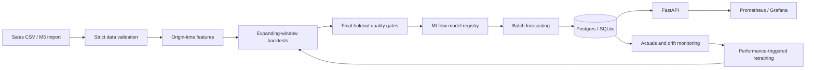

# ForecastOps

A demand forecasting platform that trains, evaluates, registers, serves, and monitors retail models through reproducible batch workflows.

This repository contains a working local MLOps implementation. The default demo uses **synthetic data**. A separate [frozen M5 experiment](docs/m5-results.md) now records a real-data benchmark on 50 products across three stores; AWS deployment remains unproven.

The [2026-10-11 implementation audit](docs/implementation-audit.md) records the original findings and subsequent fixes. Horizon-aware monitoring, freshness checks, recoverable promotion and container provenance now have regression coverage. Forecast batches now retain immutable issuance history, and an isolated Postgres/HTTP-MLflow/API test exercises the operational path. Cloud deployment and calibrated uncertainty remain unproven; treat this as a prototype.



## Run locally

Requires Python 3.12 and [uv](https://docs.astral.sh/uv/). On macOS, XGBoost also needs the OpenMP runtime (`brew install libomp`). Run commands from this repository's root.

```bash
uv sync --frozen --python 3.12
uv run forecastops demo
uv run uvicorn forecastops.api.app:app --host 127.0.0.1 --port 8000
```

Open [API documentation](http://localhost:8000/docs). The synthetic demo uses historical dates; select its explicit `forecast_date` when querying forecasts. `/ready` and default forecast queries intentionally reject stale batches. The demo creates 240 days, three stores and eight products, trains four models, logs their experiments, applies promotion gates, then saves fourteen-day forecasts. It refuses to overwrite an existing input file; rerun `train` and `forecast` explicitly, or give a fresh path to `demo --data data/raw/another-demo.csv`.

```bash
uv run forecastops validate --data data/raw/demo.csv
uv run forecastops train --data data/raw/demo.csv
uv run forecastops forecast --data data/raw/demo.csv
uv run forecastops monitor --replay --data data/raw/demo.csv
uv run mlflow server --backend-store-uri sqlite:///artifacts/mlflow.db --host 127.0.0.1 --port 5000
```

Settings use the `FORECASTOPS_` prefix; copy `.env.example` to `.env` to change them. Defaults use local SQLite and MLflow, with all state under `artifacts/` and `mlruns/`. `--no-tracking` is an explicit test mode that uses local artifacts instead of MLflow. It is not the standard demo path.

## Run the complete stack

```bash
docker compose up --build -d --wait
docker compose run --rm worker forecastops demo
```

Five persistent services run: FastAPI, Postgres, MLflow, Prometheus and Grafana. The worker is an on-demand sixth container. Named volumes retain datasets, predictions, models and dashboards across restarts. The API can be healthy before any model has been promoted; it then returns 404 for unavailable forecasts.

| Service | Local address |
|---|---|
| API / OpenAPI | [localhost:8000/docs](http://localhost:8000/docs) |
| MLflow | [localhost:5000](http://localhost:5000) |
| Prometheus | [localhost:9090](http://localhost:9090) |
| Grafana | [localhost:3000](http://localhost:3000) |

Grafana's local demo login is `admin` / `local-demo-only`. Ports bind to localhost. These credentials and this unauthenticated API are for a local demo. Cloud ingress must be restricted until authentication and TLS are added. Stop the stack with `docker compose down`; this preserves its named volumes.

To retrain or monitor an existing Docker dataset:

```bash
docker compose run --rm worker forecastops train --data data/raw/demo.csv
docker compose run --rm worker forecastops cycle --data data/raw/demo.csv
```

## Data contract and M5

Input columns are `store_id`, `item_id`, `category`, `date`, `demand`, and `price`. Each store/item pair must have a unique, complete daily history with common start/end dates. Identifiers must be nonempty strings; demand must be finite and nonnegative; price must be finite and positive; categories must remain stable within a series. Forecasting also verifies the series/category universe against the champion.

Download the official [M5 competition data](https://www.kaggle.com/competitions/m5-forecasting-accuracy/data) after accepting its terms. Credentials and licensed data are not included. Place `sales_train_evaluation.csv` (or `sales_train_validation.csv`), `calendar.csv` and `sell_prices.csv` together, then run:

```bash
uv run forecastops ingest-m5 --directory /path/to/m5 \
  --stores CA_1 TX_1 WI_1 --items 100 --days 730 \
  --output data/processed/m5.csv
uv run forecastops train --data data/processed/m5.csv
uv run forecastops forecast --data data/processed/m5.csv
```

The importer selects common products with complete observed prices and never fabricates pre-launch prices or missing sales. It can fail if too few products satisfy the contract. Start with fewer products on memory-constrained machines: direct multi-horizon training expands the training rows by up to fourteen times and currently uses dense one-hot encoding. Full M5-scale training is not yet optimized or benchmarked. Calendar events and scheduled promotions are deliberately not features in V1.

## Forecasting and promotion rules

The forecast origin is **end of day, after demand is observed**. `lag_1` is that day's observed demand, `lag_7` is six days earlier, and `lag_28` is twenty-seven days earlier. Rolling statistics include the origin day. Models receive the last observed price, price change, store/item/category, target weekday/month/weekend, horizon and historical demand features. They never receive realized target-day prices or sales. Ingestion must enforce that origin-day actuals are genuinely available before the batch runs.

Models are seasonal naive (repeat the last complete week), seven-day mean, Ridge and XGBoost. One direct model predicts horizons 1–14; inference never feeds validation actuals back into its features. The default evaluation uses three expanding-window folds, followed by a separate fourteen-day holdout. All labels in a training fold end on or before its cutoff.

The CV winner is eligible for promotion only when it:

- Beats the seasonal baseline in every CV window.
- Improves final-holdout WAPE by at least 2% relative to the baseline and any incumbent.
- Has no store/category MAE regression above 10% relative to either reference.
- Generates the configured batch within the thirty-second latency limit.

The incumbent comparison uses the frozen production artifact. A retraining run needs a full holdout window after the incumbent's training cutoff; overlapping data cannot promote another model. Failed promotion retains the previous champion. With no champion and a failed gate, the system publishes no forecasts. The winning recipe is refitted on all available history only after its evaluation.

MAE, RMSE, WAPE, sMAPE and signed bias are stored overall and by store/category. WAPE is a fraction and is `null` when total actual demand is zero. A symmetric interval uses the 90th percentile of pooled CV absolute errors, clipped at zero. These are empirical error bands, **not calibrated coverage guarantees**, and are not horizon-specific.

The final holdout is used for the promotion decision, so it is an evaluation gate rather than an unbiased long-term performance estimate. Repeated human tuning against the same holdout compromises its independence. Use later unseen actuals for the portfolio's final performance claims.

## Model registry and audit trail

MLflow records each model's CV metrics, selected-model holdout results, dataset SHA-256, seed, feature version, training cutoff and Git commit when available. The selected artifact is registered even if rejected; only a passing model receives the `champion` alias. This follows MLflow's [alias-based registry workflow](https://mlflow.org/docs/latest/ml/model-registry/workflow/).

Each run also writes a local report, model artifact and fold-level forecast CSVs under `artifacts/runs/<version>/`. `champion.json` pins the promoted MLflow version URI, so later batch jobs load an immutable registered version rather than an alias that could change mid-batch. CLI commands share a filesystem lock. These files are operational state: back them up with the MLflow store. `champion.json` is the authoritative commit point. Registration does not move the alias: the pipeline saves a pending journal, commits the pointer, then updates the alias. Worker commands retry pending reconciliation; `forecastops reconcile` forces repair from the current pointer, including after rollback. An unavailable alias service leaves `promotion.json` pending and emits a warning. See [the runbook](docs/runbook.md).

Training reports also record source-content and dependency-lock hashes, working-tree state, gate settings and the compared incumbent version. CI and deployment builds inject their revision into the container. Manual builds can supply `--build-arg GIT_COMMIT=$(git rev-parse HEAD)` and an accurate `GIT_DIRTY` value; omitted metadata is explicitly `unknown`.

## Forecast API

```bash
curl 'http://localhost:8000/forecasts/items/ITEM_001?store_id=STORE_1&horizon=7'
curl 'http://localhost:8000/forecasts/stores/STORE_1?limit=100&offset=0'
curl 'http://localhost:8000/models/current'
curl 'http://localhost:8000/health'
curl 'http://localhost:8000/ready'
curl 'http://localhost:8000/metrics'
```

Responses contain forecast date, target date, series identifiers, prediction, bounds, model version and creation time. Forecast endpoints return a list, with `limit`/`offset` pagination. Use `forecast_date=YYYY-MM-DD` for the active batch at an origin, or `batch_id=<64-character-content-hash>` for an exact retained batch. Responses include `batch_id`; an unknown ID returns 404 and a malformed ID returns 422. The default is the latest global batch, returning 503 if its origin exceeds the configured age or its model is superseded. Explicit historical queries remain available; missing products never silently fall back to older batches. `/health` checks service/database availability; `/ready` requires a fresh batch for the committed champion. Horizons must be 1–14. Writes append a distinct batch and atomically update its origin's active pointer. Identical content, including model version, reuses the same batch without changing issuance timestamps. Older batches remain retrievable even after replacement or rollback; failed transactions publish nothing. Existing legacy rows migrate once with their original timestamps, while the old table is retained. Follow the [migration runbook](docs/runbook.md) before upgrading a shared installation.

## Monitoring and retraining

`monitor` selects the first timely prediction for each origin/target/series across all model versions. Revisions never replace that evaluation evidence. Live issuance must fall within the declared origin UTC day and before the monitoring clock; a late backfill cannot masquerade as a longer-lead forecast. This conservative cutoff requires timely processing; input actuals still lack availability timestamps. `by_model` retains scores for previous models as their forecasts mature. Only current-champion forecasts contribute to automatic retraining, with horizon-matched holdout errors and coverage against the full recent seven-day series panel. Older model reports without horizon references return `reference_unavailable` rather than substituting pooled errors.

Retraining requires at least 80% coverage and seven matched observations at a horizon, with its WAPE exceeding both that horizon's holdout WAPE × 1.25 and an absolute increase of 0.02. Any qualifying degraded horizon triggers review/retraining; pooled WAPE is descriptive only. Changed series, stale/future-dated actuals and explicit `monitor --replay` runs cannot trigger automatic retraining. Replay reports expose `would_retrain` for diagnosis and are never exported as live monitoring. The demo uses replay mode.

Drift references use the latest 28 days from every training series with equal series weight. Prediction PSI compares against saved CV predictions. These remain pooled heuristics sensitive to seasonality and mix changes. Drift alone raises an alert.

`cycle` checks the new signal, defers training until a complete post-incumbent holdout exists, applies normal gates, then publishes forecasts. A training failure is reported while still attempting a batch with the committed champion. A stale request file alone never triggers training. Run `cycle` after daily actuals ingestion with your scheduler; scheduling is not installed automatically.

Defaults allow two UTC calendar days of data/forecast age and 48 hours of report age, configured by `FORECASTOPS_MAX_DATA_AGE_DAYS`, `FORECASTOPS_MAX_FORECAST_AGE_DAYS` and `FORECASTOPS_MAX_REPORT_AGE_SECONDS`. Legacy, expired, replayed or future-dated reports export unavailable WAPE and no live retraining signal. Prometheus exposes freshness, ages, readiness and per-horizon WAPE/coverage alongside HTTP and drift metrics. Alerts cover missing/stale monitoring and forecast publication. Grafana's nine existing panels have not yet been expanded for the new horizon metrics; external notification routing is not configured.

## Measured synthetic demo

The following results came from the local 2026-10-10 run with 5,760 simulated observations, 24 series, three CV windows and a fourteen-day holdout. They are reproducibility evidence, **not M5 performance**. The [saved results](docs/demo-results.json) record the dataset hash and configuration.

| Model | CV WAPE | CV MAE |
|---|---:|---:|
| Seasonal naive | 6.176% | 1.762 |
| Moving average | 24.461% | 6.979 |
| Ridge | 5.790% | 1.652 |
| XGBoost | 5.578% | 1.591 |

XGBoost's holdout WAPE was **5.413%**, compared with **5.652%** for the seasonal baseline: a **4.24% relative improvement**. It passed the gate and produced 336 future rows. API latency is not claimed as a production benchmark.

## Verification and cloud status

```bash
uv run ruff check .
uv run ruff format --check .
uv run pytest -q
```

CI runs linting, formatting, leakage/validation tests, training and API integration tests, an MLflow demo smoke run with explicit promotion/alias/database/API assertions, Terraform validation and a Docker build. CI also starts an isolated Postgres/HTTP-MLflow/API stack, runs the container worker, repeats inference to check batch idempotency, and retrieves both original and replacement batches through HTTP. Nine database contract tests run against both SQLite and PostgreSQL, including concurrency, migration recovery and transactional rollback. Synthetic fixtures use temporary directories or disposable test volumes. The local suite passes 66 tests; the pinned pandas/NumPy and Starlette/httpx combinations currently emit deprecation warnings.

The [Terraform module](infra/terraform/README.md) defines ECR, S3, ECS/Fargate, EFS and CloudWatch, with external Postgres, MLflow and networking supplied as inputs. A manual GitHub Actions deployment workflow publishes an immutable image and waits for ECS service stability. The [initial GitHub CI run](https://github.com/robbyfa/ForecastOps/actions/runs/38066120932) passed and its synthetic demo produced 84 forecasts. **No AWS resources have been provisioned and no live cloud reliability claims are made.** The cloud milestone requires account configuration, a reviewed plan, deployment and measured end-to-end evidence.

The first [M5 benchmark](docs/m5-results.md) measured XGBoost holdout WAPE of 84.79% versus 102.05% for seasonal naive, a 16.91% relative reduction, on 109,500 observations. Its worse sMAPE and small CV advantage over Ridge are documented alongside the selected WAPE improvement. Next milestones are the audit fixes, calibrated per-horizon intervals, feature-memory optimization, scheduled ingestion, cloud deployment and a production observation period. Core logic lives in Python modules; there are no LLM, agent, vector database or orchestration-framework dependencies in the forecasting system.
