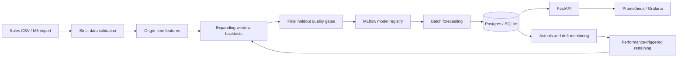

# ForecastOps

A demand forecasting platform that trains, evaluates, registers, serves, and monitors retail models through reproducible batch workflows.

This repository contains a working local MLOps implementation. The included demo uses **synthetic data**, not Walmart data. M5 ingestion is implemented, but no M5 benchmark or AWS deployment is claimed.



## Run locally

Requires Python 3.12 and [uv](https://docs.astral.sh/uv/). On macOS, XGBoost also needs the OpenMP runtime (`brew install libomp`). Run commands from this repository's root.

```bash
uv sync --frozen --python 3.12
uv run forecastops demo
uv run uvicorn forecastops.api.app:app --host 127.0.0.1 --port 8000
```

Open [API documentation](http://localhost:8000/docs). The demo creates 240 days, three stores and eight products, trains four models, logs their experiments, applies promotion gates, then saves fourteen-day forecasts. It refuses to overwrite an existing input file; rerun `train` and `forecast` explicitly, or give a fresh path to `demo --data data/raw/another-demo.csv`.

```bash
uv run forecastops validate --data data/raw/demo.csv
uv run forecastops train --data data/raw/demo.csv
uv run forecastops forecast --data data/raw/demo.csv
uv run forecastops monitor --data data/raw/demo.csv
uv run mlflow server --backend-store-uri sqlite:///artifacts/mlflow.db --host 127.0.0.1 --port 5000
```

Settings use the `FORECASTOPS_` prefix; copy `.env.example` to `.env` to change them. Defaults use local SQLite and MLflow, with all state under `artifacts/` and `mlruns/`. `--no-tracking` is an explicit test mode that uses local artifacts instead of MLflow. It is not the standard demo path.

## Run the complete stack

```bash
docker compose up --build -d --wait
docker compose run --rm worker forecastops demo
```

Five persistent services run: FastAPI, Postgres, MLflow, Prometheus and Grafana. The worker is an on-demand sixth container. Named volumes retain datasets, predictions, models and dashboards across restarts. The API can be healthy before any model has been promoted; it then returns 404 for unavailable forecasts.

| Service | Local address |
|---|---|
| API / OpenAPI | [localhost:8000/docs](http://localhost:8000/docs) |
| MLflow | [localhost:5000](http://localhost:5000) |
| Prometheus | [localhost:9090](http://localhost:9090) |
| Grafana | [localhost:3000](http://localhost:3000) |

Grafana's local demo login is `admin` / `local-demo-only`. Ports bind to localhost. These credentials and this unauthenticated API are for a local demo. Cloud ingress must be restricted until authentication and TLS are added. Stop the stack with `docker compose down`; this preserves its named volumes.

To retrain or monitor an existing Docker dataset:

```bash
docker compose run --rm worker forecastops train --data data/raw/demo.csv
docker compose run --rm worker forecastops cycle --data data/raw/demo.csv
```

## Data contract and M5

Input columns are `store_id`, `item_id`, `category`, `date`, `demand`, and `price`. Each store/item pair must have a unique, complete daily history with common start/end dates. Identifiers must be nonempty strings; demand must be finite and nonnegative; price must be finite and positive; categories must remain stable within a series. Forecasting also verifies the series/category universe against the champion.

Download the official [M5 competition data](https://www.kaggle.com/competitions/m5-forecasting-accuracy/data) after accepting its terms. Credentials and licensed data are not included. Place `sales_train_evaluation.csv` (or `sales_train_validation.csv`), `calendar.csv` and `sell_prices.csv` together, then run:

```bash
uv run forecastops ingest-m5 --directory /path/to/m5 \
  --stores CA_1 TX_1 WI_1 --items 100 --days 730 \
  --output data/processed/m5.csv
uv run forecastops train --data data/processed/m5.csv
uv run forecastops forecast --data data/processed/m5.csv
```

The importer selects common products with complete observed prices and never fabricates pre-launch prices or missing sales. It can fail if too few products satisfy the contract. Start with fewer products on memory-constrained machines: direct multi-horizon training expands the training rows by up to fourteen times and currently uses dense one-hot encoding. Full M5-scale training is not yet optimized or benchmarked. Calendar events and scheduled promotions are deliberately not features in V1.

## Forecasting and promotion rules

The forecast origin is **end of day, after demand is observed**. `lag_1` is that day's observed demand, `lag_7` is six days earlier, and `lag_28` is twenty-seven days earlier. Rolling statistics include the origin day. Models receive the last observed price, price change, store/item/category, target weekday/month/weekend, horizon and historical demand features. They never receive realized target-day prices or sales. Ingestion must enforce that origin-day actuals are genuinely available before the batch runs.

Models are seasonal naive (repeat the last complete week), seven-day mean, Ridge and XGBoost. One direct model predicts horizons 1–14; inference never feeds validation actuals back into its features. The default evaluation uses three expanding-window folds, followed by a separate fourteen-day holdout. All labels in a training fold end on or before its cutoff.

The CV winner is eligible for promotion only when it:

- Beats the seasonal baseline in every CV window.
- Improves final-holdout WAPE by at least 2% relative to the baseline and any incumbent.
- Has no store/category MAE regression above 10% relative to either reference.
- Generates the configured batch within the thirty-second latency limit.

The incumbent comparison uses the frozen production artifact. A retraining run needs a full holdout window after the incumbent's training cutoff; overlapping data cannot promote another model. Failed promotion retains the previous champion. With no champion and a failed gate, the system publishes no forecasts. The winning recipe is refitted on all available history only after its evaluation.

MAE, RMSE, WAPE, sMAPE and signed bias are stored overall and by store/category. WAPE is a fraction and is `null` when total actual demand is zero. A symmetric interval uses the 90th percentile of pooled CV absolute errors, clipped at zero. These are empirical error bands, **not calibrated coverage guarantees**, and are not horizon-specific.

The final holdout is used for the promotion decision, so it is an evaluation gate rather than an unbiased long-term performance estimate. Repeated human tuning against the same holdout compromises its independence. Use later unseen actuals for the portfolio's final performance claims.

## Model registry and audit trail

MLflow records each model's CV metrics, selected-model holdout results, dataset SHA-256, seed, feature version, training cutoff and Git commit when available. The selected artifact is registered even if rejected; only a passing model receives the `champion` alias. This follows MLflow's [alias-based registry workflow](https://mlflow.org/docs/latest/ml/model-registry/workflow/).

Each run also writes a local report, model artifact and fold-level forecast CSVs under `artifacts/runs/<version>/`. `champion.json` pins the promoted MLflow version URI, so later batch jobs load an immutable registered version rather than an alias that could change mid-batch. CLI commands share a filesystem lock. These files are operational state: back them up with the MLflow store. V1 does not provide a distributed transaction across MLflow and the local pointer, so a crash during promotion may require reconciliation; see [the runbook](docs/runbook.md).

## Forecast API

```bash
curl 'http://localhost:8000/forecasts/items/ITEM_001?store_id=STORE_1&horizon=7'
curl 'http://localhost:8000/forecasts/stores/STORE_1?limit=100&offset=0'
curl 'http://localhost:8000/models/current'
curl 'http://localhost:8000/health'
curl 'http://localhost:8000/metrics'
```

Responses contain forecast date, target date, series identifiers, prediction, bounds, model version and creation time. Forecast endpoints return a list, with `limit`/`offset` pagination. Use `forecast_date=YYYY-MM-DD` to select a historical batch. The default is the latest global batch; missing products never silently fall back to stale forecasts. Horizons must be 1–14. Writes replace a complete origin-date batch in a database transaction; failed writes roll back.

## Monitoring and retraining

`monitor` joins issued forecasts to subsequently observed actuals, using the most recently issued prediction for each store/item/target date and only the current model version. It reports seven-day performance, coverage, demand/price PSI and KS statistics, prediction drift and changed series. Monitoring uses the same strict validation as training, so invalid data fails the job before any retraining can proceed.

Retraining requires at least 80% coverage of the recent seven-day panel and WAPE exceeding both the champion holdout WAPE × 1.25 and an absolute increase of 0.02. Drift alone raises an alert. `cycle` checks current monitoring results, trains once per model/as-of-date trigger, applies the same promotion gates, and issues a new batch. A stale request file never triggers retraining by itself. Run `cycle` after a daily actuals ingestion job using your scheduler; a scheduler is not installed automatically. The initial demo has no later actuals and correctly reports `awaiting_actuals`.

Prometheus exports HTTP count/latency/5xx, database retrieval latency, champion version, coverage, WAPE, PSI and retraining status. Grafana is provisioned with nine panels. Alert rules exist for service failure, drift and degradation; external notification routing is not configured.

## Measured synthetic demo

The following results came from the local 2026-10-10 run with 5,760 simulated observations, 24 series, three CV windows and a fourteen-day holdout. They are reproducibility evidence, **not M5 performance**. The [saved results](docs/demo-results.json) record the dataset hash and configuration.

| Model | CV WAPE | CV MAE |
|---|---:|---:|
| Seasonal naive | 6.176% | 1.762 |
| Moving average | 24.461% | 6.979 |
| Ridge | 5.790% | 1.652 |
| XGBoost | 5.578% | 1.591 |

XGBoost's holdout WAPE was **5.413%**, compared with **5.652%** for the seasonal baseline: a **4.24% relative improvement**. It passed the gate and produced 336 future rows. API latency is not claimed as a production benchmark.

## Verification and cloud status

```bash
uv run ruff check .
uv run ruff format --check .
uv run pytest -q
```

CI runs linting, formatting, leakage/validation tests, training and API integration tests, an MLflow demo smoke run, Terraform validation and a Docker build. Synthetic fixtures are generated deterministically in temporary directories. The local suite passes 26 tests; the pinned pandas/NumPy and Starlette/httpx combinations currently emit deprecation warnings.

The [Terraform module](infra/terraform/README.md) defines ECR, S3, ECS/Fargate, EFS and CloudWatch, with external Postgres, MLflow and networking supplied as inputs. A manual GitHub Actions deployment workflow publishes an immutable image and waits for ECS service stability. **No AWS resources have been provisioned, no remote CI run has been observed, and no live cloud reliability claims are made.** The cloud milestone requires account configuration, a reviewed plan, deployment and measured end-to-end evidence.

Next portfolio milestones are a licensed M5 benchmark, calibrated per-horizon intervals, feature-memory optimization, scheduled ingestion, cloud deployment and a production observation period. Core logic lives in Python modules; there are no LLM, agent, vector database or orchestration-framework dependencies in the forecasting system.
